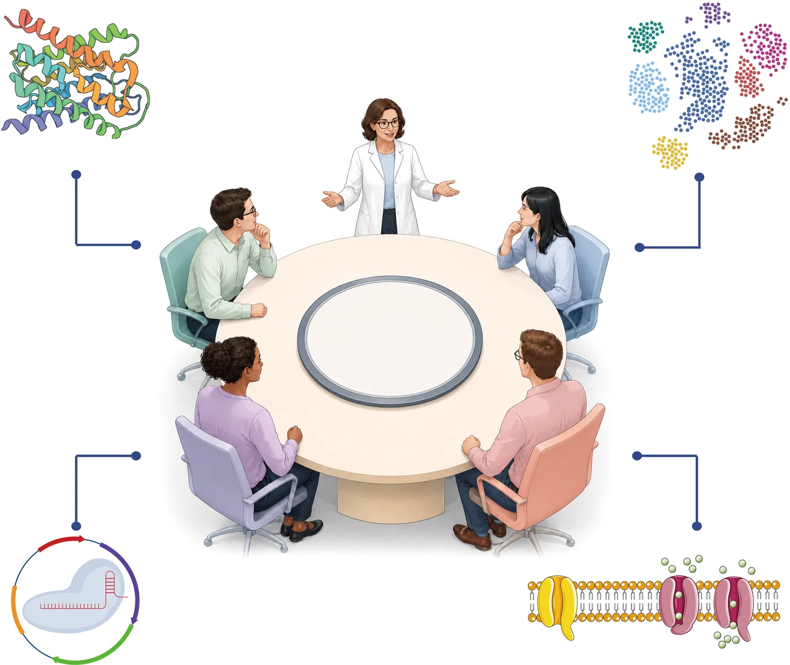
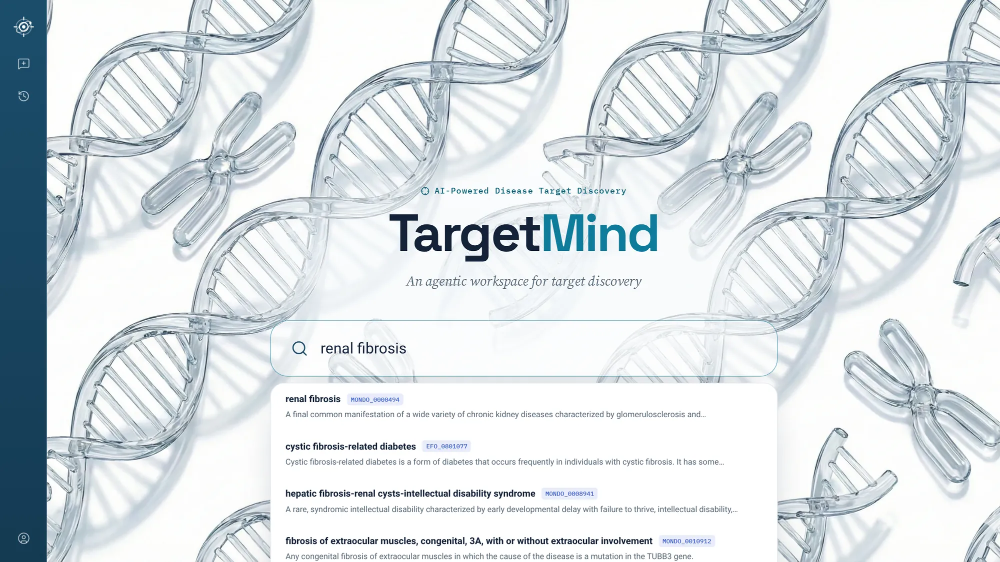

<div align="center">

<picture>
  <source media="(prefers-color-scheme: dark)" srcset="assets/targetmind-lockup-dark.svg">
  
</picture>

<br>
<br>

### A virtual target review board, built from AI experts.

A multi-agent system for therapeutic target discovery.

<br>

[](#quick-start)
[](#quick-start)
[](#quick-start)
[](#quick-start)
[](#quick-start)
[](LICENSE)

</div>

<br>

<!-- Demo: GitHub strips <video> unless it points at a user-attachments upload, so an
     animated preview links to the full-length video instead. -->
<div align="center">

<a href="assets/targetmind-demo.mp4">
  
</a>

<sub>Click to watch the full 76 s demo — three diseases, one workspace: renal fibrosis, ADPKD and HCM.
<br>Candidate target names are blurred. &nbsp;<a href="assets/targetmind-demo.mp4">MP4</a> · <a href="assets/targetmind-demo.webm">WebM</a></sub>

</div>

<br>

## Overview

Evidence for a new therapeutic target is scattered across genetics, omics, the
literature and pharmacology. Turning it into a defensible decision has depended on
experts integrating it by hand.

**TargetMind** automates that review board. Independent expert agents evaluate each
candidate from their own discipline; an **evidence-gap-guided consensus** step makes
them resolve cross-disciplinary contradictions before anything is ranked. The result
is an **autonomous, scalable and fully traceable** target-selection funnel.

<div align="center">
<br>

<br>
<sub>The virtual roundtable: a Chief Scientist convenes four independent domain experts.</sub>
</div>

<br>

### Beyond linear pipelines

| | Pipelines and single agents | **TargetMind** |
|:--|:--|:--|
| **Reasoning** | One pass, one perspective | Independent evaluations, then structured deliberation |
| **Conflicting evidence** | Averaged or hidden | Classified, debated, resolved |
| **Missing evidence** | Silently treated as absence | Named as a gap, filled by targeted retrieval |
| **Output** | A ranked list | A candidate × dimension matrix, with reasons for and against |
| **Novelty** | Favours well-studied genes | Prioritises underexplored, well-supported targets |

<details>
<summary><b>Why the field needs this</b></summary>

<br>

> Approved drugs act on only about **854 human protein targets**, and roughly **one in
> five** newly approved drugs engages a novel one. About **92%** of 17,000+
> characterised diseases still have no FDA-approved treatment.

The data exists — **40 million** literature records, **6.5 million** omics samples,
**20.3 million** bioactivity measurements. What is missing is the step from data to
causal, druggable and safe targets:

- **Causality matters.** Across 28,000+ terminated trials, programmes without causal
  human genetic support were markedly more likely to fail for lack of efficacy.
- **Associations are not decisions.** Most methods stop at association, without
  assessing causal role, tractability or safety.
- **Black boxes do not translate.** Ranked lists without traceable reasoning are hard
  to act on.
- **Linear AI pipelines hallucinate.** Single-pass LLMs and agents cannot resolve
  conflicts and inherit prior-knowledge bias.

</details>

<br>

## How it works

A Chief Scientist chairs the session, experts bring their own evidence, and a target
is ranked only when it survives cross-examination.

<table>
  <tr>
    <td width="25%" valign="top"><b>1 · Nominate</b><br><sub>Knowledge-graph link prediction plus reasoning rules over human genetics propose an unbiased candidate pool.</sub></td>
    <td width="25%" valign="top"><b>2 · Evaluate</b><br><sub>Four experts assess candidates in parallel, blinded to one another, to avoid anchoring.</sub></td>
    <td width="25%" valign="top"><b>3 · Deliberate</b><br><sub>The Chief Scientist confronts the verdicts and resolves them through gap-guided consensus.</sub></td>
    <td width="25%" valign="top"><b>4 · Rank</b><br><sub>Survivors are ranked and written up with evidence, risks and open questions.</sub></td>
  </tr>
</table>

### Evidence-gap-guided consensus

Every expert finding falls into one of three categories:

| | Category | Meaning | What the board does |
|:-:|:--|:--|:--|
| 🟢 | **Aligned evidence** | Independent disciplines agree | Carried forward as support |
| 🔴 | **Critical risk** | Could invalidate the target — a contrary causal direction, a safety liability | Weighed explicitly; target down-ranked or rejected, reason recorded |
| 🟡 | **Resolvable gap** | Evidence missing or conflicting, but obtainable | Triggers **targeted retrieval** and **cross-domain review** |

Disagreement becomes signal, not noise: each round either closes a gap or exposes a
risk.

<details>
<summary><b>The target selection funnel</b></summary>

<br>

| Stage | Question the board answers |
|:--|:--|
| **Disease grounding** | Which disease, under which ontology IDs — and which related diseases and indications inform it? |
| **Candidate nomination** | Which genes do genetics, association and the knowledge graph point to? |
| **Evidence completion** | Is there human genetic, expression and causal-perturbation support? |
| **Novelty screen** | Is the target already established in the literature, clinic or as a classic marker? |
| **Multi-dimensional evaluation** | Is it causal, expressed where it matters, tractable and safe? |
| **Consensus and ranking** | Where do experts agree, where not, and what would change the verdict? |

</details>

<br>

## The expert panel

| Agent | Evidence dimension | Delivers |
|:--|:--|:--|
| 🧑‍🔬 **Chief Scientist** | Chairs the roundtable | Plan, nomination, novelty screen, consensus, final report |
| 🧬 **Genetics** | Human genetics, constraint | GWAS and credible sets, rare variants, direction of effect |
| 🔬 **Disease Biology** | Mechanism, causality | Knockout, knock-down and pharmacology studies; pathway context |
| 📊 **Omics** | Expression, clinical relevance | Differential expression, cell-type attribution, severity association |
| 💊 **Medicinal Chemistry** | Druggability, safety | Tractability, known ligands, structural pockets, tissue safety |

<br>

## Features

<table>
  <tr>
    <td width="33%" valign="top">
      <b>Expert collaboration</b>
      <ul>
        <li>A review board, not a chatbot</li>
        <li>Contradictions debated, not averaged</li>
        <li>A live plan shows every funnel stage</li>
      </ul>
    </td>
    <td width="33%" valign="top">
      <b>Evidence you can trace</b>
      <ul>
        <li>Novel targets need ≥ 2 independent evidence lines</li>
        <li>Known, emerging and novel targets told apart</li>
        <li>Conclusions from retrieved data, never recall alone</li>
      </ul>
    </td>
    <td width="33%" valign="top">
      <b>Research-grade infrastructure</b>
      <ul>
        <li>Open Targets, GWAS, GTEx, PrimeKG, ChEMBL and more</li>
        <li>Real analysis in isolated Python / R sandboxes</li>
        <li>Every result a file: tables, code, figures, 3D structures</li>
      </ul>
    </td>
  </tr>
</table>

<details>
<summary><b>Data foundation</b></summary>

<br>

| Domain | Sources |
|:--|:--|
| Target–disease association | Open Targets Platform — scores, clinical candidates, credible sets |
| Human genetics | GWAS Catalog · gnomAD constraint · HGNC |
| Expression | GTEx · Human Protein Atlas · GEO |
| Knowledge graph | PrimeKG embeddings |
| Pathways | MSigDB Hallmark · Reactome · GO BP · KEGG |
| Chemistry and structure | ChEMBL · PubChem · PDB · UniProt |
| Literature and trials | PubMed · ClinicalTrials.gov |

</details>

<br>

## Workflows

<details>
<summary><b>Discover novel targets</b> — <i>"Find novel therapeutic targets for renal fibrosis and give me a ranked report."</i></summary>

<br>

1. **Ground the disease.** Anchor it to ontology IDs and pick the related diseases, traits and indications that should inform the search.
2. **Nominate.** Genetic association, GWAS and knowledge-graph link prediction propose several hundred candidates.
3. **Complete the evidence.** *Omics* runs differential expression on matched kidney datasets, *Genetics* reviews human support, *Disease Biology* collects perturbation studies.
4. **Screen for novelty.** Genes with ≥ 2 independent lines are checked against literature and clinical pipelines; established targets are set aside, reason recorded.
5. **Deliberate.** All four experts score the shortlist; gaps trigger a targeted follow-up.
6. **Report.** Ranked targets with evidence for and against, disagreements, limitations and next experiments.

</details>

<details>
<summary><b>Pressure-test known targets</b> — <i>"We are considering three genes for hypertrophic cardiomyopathy. Evaluate them."</i></summary>

<br>

1. The Chief Scientist skips nomination and resolves the named genes and related indications.
2. A novelty screen places each gene on the known / emerging / novel spectrum and flags existing clinical programmes.
3. The four experts evaluate every gene independently.
4. The board reconciles the verdicts and reports, per gene and dimension, the decisive evidence and what would change the conclusion.

</details>

<details>
<summary><b>Ask one focused question</b> — <i>"What is the human genetic evidence linking this gene to chronic kidney disease?"</i></summary>

<br>

A one-dimension question is routed to exactly one expert — here *Genetics* — which
returns the strongest associations, credible sets, rare-variant evidence and
direction of effect, each with its source.

</details>

<br>

## Validation

Evaluated computationally and at the bench.

- **Benchmarking** — in target-focused reasoning, TargetMind significantly outperforms state-of-the-art biomedical agents while uniquely prioritising underexplored targets with robust disease-linked support.
- **Wet-lab validation** in three diseases with high translational failure and no curative options:

| Disease | Result |
|:--|:--|
| **Renal fibrosis** | A novel first-in-class target, validated in mice, non-human primates and human clinical samples |
| **ADPKD** (autosomal dominant polycystic kidney disease) | One inhibition and one activation target, validated *in vitro* and *in vivo* |
| **HCM** (hypertrophic cardiomyopathy) | One inhibition target, validated *in vitro* and *in vivo* |

<br>

## Quick start

**Requirements** — Python 3.12 · Node.js 22 · Docker · PostgreSQL 16

```bash
git clone https://github.com/CHAOJICHENG5/TargetMind.git
cd TargetMind

# 1. Python environment and agent tools
python -m venv .venv && source .venv/bin/activate
pip install -r requirements.txt

# 2. Platform service
uvicorn targetmind.server.app:app --host 0.0.0.0 --port 12000

# 3. Web workspace
cd frontend
npm install
npm run dev          # http://localhost:3001
```

<details>
<summary>Run the agent tools standalone</summary>

<br>

```bash
python sandbox/tools/tm_lit.py --help        # literature search
python sandbox/tools/tm_discover.py --help   # candidate pool, evidence matrix, shortlist
```

</details>

<div align="center">
<br>

<br>
<sub>Start from a disease: search is grounded in EFO / MONDO ontology identifiers.</sub>
</div>

<br>

---

<div align="center">

<a href="https://www.lilab-ecust.cn/targetmind/"><b>lilab-ecust.cn/targetmind</b></a>

<br>

<sub>Copyright © 2026 TargetMind. All rights reserved. See <a href="LICENSE">LICENSE</a>.</sub>

</div>
